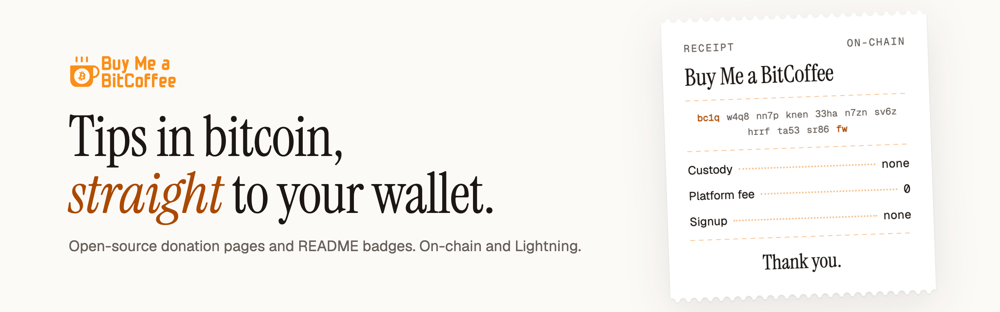
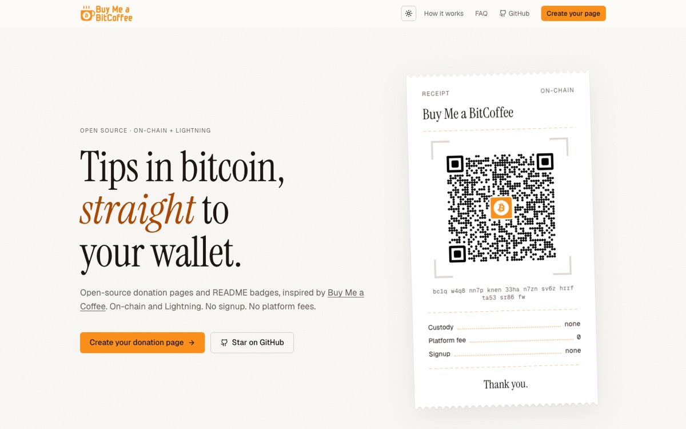
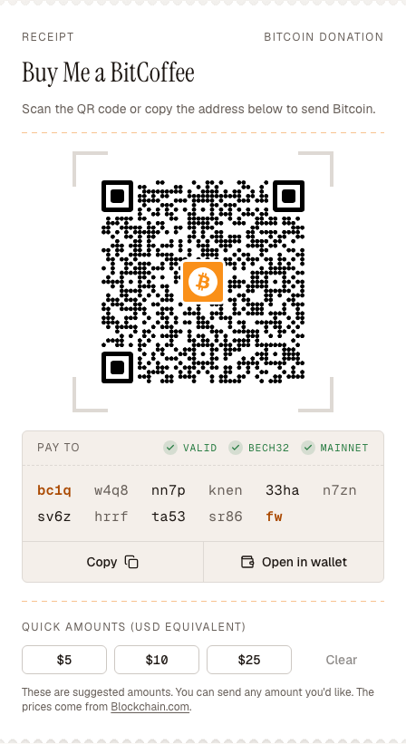

<div align="center">

<picture>
  <source media="(prefers-color-scheme: dark)" srcset="docs/readme/banner-dark.png">
  
</picture>

Open-source donation pages and README badges for Bitcoin.<br>
On-chain and Lightning. No signup, no custody, no platform fees.

**[Live app](https://buymeabitcoffee.vercel.app)** · **[Create your page](https://buymeabitcoffee.vercel.app/#get-started)** · **[Donate](https://buymeabitcoffee.vercel.app/donate)**

[](https://buymeabitcoffee.vercel.app/btc/bc1qw4q8nn7pknen33han7znsv6zhrrfta53sr86fw?identifier=Buy+Me+a+BitCoffee) [](LICENSE)

</div>

## What it costs you

Itemized, nothing hidden.

| Item                       | Value              | Why                                        |
| -------------------------- | ------------------ | ------------------------------------------ |
| Custody                    | `none`             | Donations go straight to your wallet.      |
| Accounts                   | `none`             | No signup, ever.                           |
| Platform fees              | `0`                | Only standard Bitcoin network fees.        |
| Data stored on our servers | `none`             | Pages are generated from the link itself.  |
| Payment rails              | `on-chain + LN`    | One page for both. Donors scan or copy.    |
| README badges              | `Markdown + HTML`  | shields.io styles, paste once.             |
| Source code                | `open`             | Fork it, audit it.                         |
| **Total**                  |                    | **Your keys, your sats.**                  |

## What donors see

<table>
  <tr>
    <td width="62%" valign="top">
      <picture>
        <source media="(prefers-color-scheme: dark)" srcset="docs/readme/landing-dark.jpg">
        
      </picture>
      <p align="center"><sub>The generator at <a href="https://buymeabitcoffee.vercel.app">buymeabitcoffee.vercel.app</a></sub></p>
    </td>
    <td width="38%" valign="top">
      <picture>
        <source media="(prefers-color-scheme: dark)" srcset="docs/readme/receipt-dark.png">
        
      </picture>
      <p align="center"><sub>A donation page, printed as a receipt</sub></p>
    </td>
  </tr>
</table>

## Get started in three lines

1. **Enter your address.** Add your Bitcoin address and an optional Lightning address or LNURL.
2. **Copy your link or badge.** Get a shareable donation page URL and an embeddable badge snippet.
3. **Share anywhere.** Post on GitHub, your site, or social. Donors pay you directly.

[Create your page](https://buymeabitcoffee.vercel.app/#get-started). It runs entirely in your browser.

## Donation link reference

Everything a donation page needs lives in its URL. Nothing is saved on a server, so the link is the page.

```text
https://buymeabitcoffee.vercel.app/btc/<address>?identifier=<name>&lightning=<lightning>
```

| Part         | Required | Accepts                                                    |
| ------------ | -------- | ---------------------------------------------------------- |
| `<address>`  | yes      | Your on-chain Bitcoin address (the page flags invalid ones) |
| `identifier` | no       | Display name, up to 100 characters. Also the payment label |
| `lightning`  | no       | Lightning Address (`name@domain`) or LNURL, up to 1024 characters |

Values outside these limits are ignored and the page falls back to its defaults.

Example, this project's own page:

```text
https://buymeabitcoffee.vercel.app/btc/bc1qw4q8nn7pknen33han7znsv6zhrrfta53sr86fw?identifier=Buy+Me+a+BitCoffee
```

The short link [`/donate`](https://buymeabitcoffee.vercel.app/donate) points to the same page.

## README badges

The generator builds the snippet for you. Pick a style:

| `style`         | Preview |
| --------------- | ------- |
| `flat`          |  |
| `flat-square`   |  |
| `for-the-badge` |  |
| `social`        |  |

Markdown:

```md
[](https://buymeabitcoffee.vercel.app/btc/<address>?identifier=<name>)
```

HTML:

```html
<a href="https://buymeabitcoffee.vercel.app/btc/<address>?identifier=<name>"></a>
```

Prefer to serve the image from BitCoffee itself? `/api/btc` returns the same SVG, cached for 24 hours:

```text
https://buymeabitcoffee.vercel.app/api/btc?label=Donate&content=Buy%20Me%20a%20BitCoffee&style=flat
```

`label` and `content` accept up to 64 characters; `style` is one of the four above. Anything else returns `400`.

## Run it locally

Requires Node.js 24 and pnpm 10.

```bash
git clone https://github.com/cicerotcv/buymeabitcoffee.git
cd buymeabitcoffee
pnpm install
cp .env.example .env.local
pnpm dev
```

Open [http://localhost:3000](http://localhost:3000).

| Variable                               | Used for                                      |
| -------------------------------------- | --------------------------------------------- |
| `NEXT_PUBLIC_VERCEL_URL`               | Base URL in generated links and metadata      |
| `NEXT_PUBLIC_GITHUB_URL`               | GitHub links in the header and footer         |
| `NEXT_PUBLIC_EXAMPLE_BTC_ADDRESS`      | The address on the landing receipt and `/donate` |
| `NEXT_PUBLIC_EXAMPLE_LIGHTNING_ADDRESS` | Optional Lightning address for `/donate`     |

| Script              | Does                                  |
| ------------------- | ------------------------------------- |
| `pnpm dev`          | Development server (Turbopack)        |
| `pnpm build`        | Production build                      |
| `pnpm start`        | Serve the production build            |
| `pnpm lint`         | Type check and ESLint                 |
| `pnpm tests:run`    | Unit tests (Vitest)                   |
| `pnpm prettier:fix` | Format the source                     |

## Contributing

Issues and pull requests are welcome.

- Found a bug or have an idea? [Open an issue](https://github.com/cicerotcv/buymeabitcoffee/issues).
- Pull requests target `main`, use [Conventional Commits](https://www.conventionalcommits.org/) and pass `pnpm lint && pnpm tests:run`.
- Like the project? Star it, or [buy it a bitcoffee](https://buymeabitcoffee.vercel.app/donate).

## Security

Please report vulnerabilities privately through [GitHub Security Advisories](https://github.com/cicerotcv/buymeabitcoffee/security/advisories/new), not in a public issue.

## Built with

Next.js (App Router), Tailwind CSS 4, shadcn/ui on Radix, React Hook Form with Zod, and TanStack Query.

## License

[GNU General Public License v3.0](LICENSE).

<div align="center">
<br>

**Thank you.**

<sub>Your keys, your sats.</sub>

</div>
